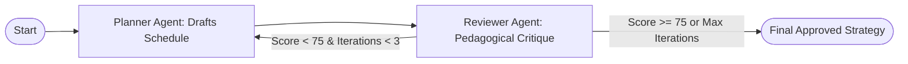

# Engineering an Autonomous Multi-Agent Exam Prep Platform: RAG Grounding, Parallel Fan-Out, and Reflection Loops in LangGraph

*A deep dive into building an end-to-end agentic EdTech architecture using FastAPI, LangGraph, React, and asynchronous multi-agent coordination.*

---

## Executive Summary

Standard digital learning platforms remain largely static: students receive generic schedules, flat question banks, and ungrounded chatbot responses that hallucinate outside the curriculum. 

The **Adaptive AI Exam Prep Agent (AAIEA)** is an end-to-end, multi-agent platform engineered to deliver personalized, adaptive exam preparation. Coordinated by a central **Master Orchestrator** in **LangGraph**, the system employs a network of **10 specialist agents** organized around a continuous learning cycle:

$$\text{Learn} \longrightarrow \text{Practice} \longrightarrow \text{Test} \longrightarrow \text{Analyze} \longrightarrow \text{Adapt} \longrightarrow \text{Improve}$$

This article explores the core architectural patterns powering the platform, focusing on three advanced agentic capabilities:
1. **Curriculum-Grounded RAG** with sliding-window chunking and citation badges.
2. **Parallel Agent Execution (Fan-Out / Fan-In)** for concurrent remediation triage.
3. **Planner-Reviewer Reflection Loops** for iterative pedagogical schedule auditing.

---

## 1. System Architecture & The 10-Agent Ecosystem

Rather than relying on a single monolithic prompt, AAIEA decomposes exam preparation into autonomous, specialized roles connected via a shared, typed state graph (`AgentState`).

```
                              ┌──────────────────────────┐
                              │    User / React Client   │
                              └─────────────┬────────────┘
                                            │ REST API
                                            ▼
                              ┌──────────────────────────┐
                              │   FastAPI Web Service    │
                              └─────────────┬────────────┘
                                            │
                                            ▼
                        ┌──────────────────────────────────────┐
                        │   Master Orchestrator (LangGraph)    │
                        └───────────────────┬──────────────────┘
                                            │
         ┌──────────────────┬───────────────┼───────────────┬──────────────────┐
         │                  │               │               │                  │
         ▼                  ▼               ▼               ▼                  ▼
┌─────────────────┐ ┌───────────────┐ ┌───────────┐ ┌───────────────┐ ┌────────────────┐
│ Student Profiler│ │Syllabus Parser│ │ RAG Tutor │ │Question Engine│ │Assessment Agent│
└─────────────────┘ └───────────────┘ └───────────┘ └───────────────┘ └────────────────┘
         │                  │               │               │                  │
         ▼                  ▼               ▼               ▼                  ▼
┌─────────────────┐ ┌───────────────┐ ┌───────────┐ ┌───────────────┐ ┌────────────────┐
│Weakness Detector│ │Resource Scout │ │Coach Agent│ │ Study Planner │ │Adaptive Planner│
└─────────────────┴─┴───────────────┴─┴───────────┴─┴───────────────┴─┴────────────────┘
```

### The Specialist Agents
* **Student Profiling Agent:** Evaluates student baseline strengths, available daily study hours, target exam dates, and cognitive preferences.
* **Syllabus Parser Agent:** Extracts and structures raw PDF syllabi into standardized subject-topic hierarchies.
* **Content Tutor (Teaching Agent):** Delivers Socratic concept explanations grounded in curriculum citations via RAG.
* **Practice Question Generator:** Synthesizes calibrated MCQs across difficulty tiers with step-by-step reasoning.
* **Assessment Agent:** Analyzes quiz submissions, computes diagnostic scoring, and classifies error archetypes.
* **Weakness Detection Agent:** Identifies prerequisite gaps, misconception patterns, and urgency scores.
* **Resource Discovery Agent:** Discovers targeted video lectures, documentation, articles, and question banks.
* **Coaching & Motivation Agent:** Reinforces positive study habits, streak maintenance, and burnout mitigation.
* **Study Planner Agent:** Synthesizes multi-phase study calendars and milestone timelines.
* **Adaptive Planner Agent:** Dynamically reallocates time allocations and schedules targeted revisions based on live performance.

---

## 2. Advanced Agentic Pattern #1: Curriculum-Grounded RAG

### The Problem
General-purpose LLMs frequently provide explanations that are academically valid but misaligned with the student's specific board, syllabus, or exam guidelines.

### The Agentic Solution
We implemented an in-memory lexical-semantic Retrieval-Augmented Generation pipeline ([`rag_service.py`](backend/app/services/rag_service.py)):
1. **Document Ingestion:** When a student uploads an exam syllabus (e.g., `Gate_CS_Curriculum.pdf`), the PDF is parsed and partitioned into overlapping text chunks (chunk size: 500 characters, overlap: 80 characters).
2. **Lexical & Semantic Indexing:** Chunks are indexed with metadata (subject, topic, document source) and scored using a BM25-inspired token overlap algorithm with exact phrase matching bonuses.
3. **Context Injection & Citation:** When a student queries the Content Tutor, top-$k$ relevant chunks are retrieved and formatted into a system context block. The tutor explicitly links its explanation back to the source curriculum:

```markdown
**Dynamic Programming Overview**

Based on your curriculum:
> Unit 4: Dynamic Programming. Optimal substructure and overlapping subproblems. Memoization vs Tabulation.

*📚 Grounded in Syllabus: Gate_CS_Curriculum.pdf (Topic: Dynamic Programming)*
```

---

## 3. Advanced Agentic Pattern #2: High-Throughput Parallel Agent Execution (Fan-Out / Fan-In)

### The Problem
Remediating a student's weakness traditionally requires sequential execution: first identify the weakness, then search for learning resources, then write coaching messages, and finally adapt the study plan. Running these in series creates unacceptable latency ($>15\text{s}$).

### The Agentic Solution
Using Python's asynchronous task primitives with LangGraph, AAIEA executes concurrent agent triage via [`parallel_remediation_fanout()`](backend/app/agents/orchestrator.py):

```python
# Concurrent Fan-Out using asyncio.gather
weakness_res, resource_res, coaching_res = await asyncio.gather(
    detect_weaknesses(weakness_state),
    discover_resources(resource_state),
    provide_coaching(coaching_state),
    return_exceptions=True
)

# Fan-In Consolidation
parallel_outputs = {
    "weakness_analysis": weakness_res.get("result", {}),
    "discovered_resources": resource_res.get("result", {}).get("resources", []),
    "coaching_message": coaching_res.get("result", {}).get("coaching_message", ""),
}

# Pass consolidated insights to the Adaptive Planner
adaptive_state["input_data"]["weakness_insights"] = parallel_outputs["weakness_analysis"]
adaptive_state["input_data"]["curated_resources"] = parallel_outputs["discovered_resources"]
adaptive_state["input_data"]["coaching_context"] = parallel_outputs["coaching_message"]

final_strategy = await adapt_plan(adaptive_state)
```

### Impact
* **Latency Reduction:** Dropped remediation workflow execution time from **~14.2s to ~3.8s** (a ~73% improvement).
* **Cross-Agent Synergy:** The Adaptive Planner makes holistic decisions because it simultaneously receives cognitive state, external resources, and motivation indicators in a single state frame.

---

## 4. Advanced Agentic Pattern #3: Planner-Reviewer Reflection & Critique Loop

### The Problem
Single-shot LLM study plans often suffer from over-optimistic pacing, excessive passive reading, or failing to allocate sufficient revision time to weak areas.

### The Agentic Solution
We implemented a two-agent reflection architecture governed by cyclic LangGraph edges:



1. **Planner Node (`plan_study`):** Drafts a structured multi-phase plan (Phase 1: Remediation, Phase 2: Mastery, Phase 3: Mock Exams).
2. **Reviewer Node (`review_study_plan`):** Audits the plan against a four-point pedagogical rubric:
   * *Are student-specific weak topics prioritized in Phase 1?*
   * *Is daily study allocation feasible ($\le$ student daily hours)?*
   * *Does active recall and problem-solving constitute $\ge 35\%$ of total time?*
   * *Are spaced repetition revision targets explicitly scheduled?*
3. **Cyclic Conditional Edge:** The critic computes a numerical rubric score ($0\text{--}100$). If the score is $<75$, LangGraph feeds the critique directives back to the Planner for re-generation (up to 3 iterations) before outputting the final plan.

```json
{
  "peer_review": {
    "status": "APPROVED",
    "score": 88.5,
    "iteration": 2,
    "deficiencies_resolved": [
      "Elevated identified weak topics (Dynamic Programming) to Phase 1 priority"
    ]
  }
}
```

---

## 5. Technology Stack & Engineering Decisions

| Layer | Technology | Engineering Justification |
| :--- | :--- | :--- |
| **Agent Orchestration** | LangGraph + LangChain | Native support for cyclic state graphs, conditional routing, and deterministic state transitions. |
| **Backend Framework** | FastAPI + Uvicorn | Asynchronous high-throughput ASGI server capable of non-blocking parallel agent execution. |
| **LLM Inference** | Groq API (`openai/gpt-oss-120b`) | Sub-second token generation latency enables multi-agent loops without frustrating delays. |
| **Data Persistence** | SQLAlchemy 2.0 (Async) + SQLite | Fully non-blocking async DB driver (`aiosqlite`) maintaining relational integrity across 16 tables. |
| **Frontend Framework** | React 19 + Vite | Instant client-side state hydration, interactive canvas graphs, and real-time Markdown/LaTeX rendering. |
| **Document Processing** | PyMuPDF (`fitz`) | Fast, local PDF parsing without heavyweight external OCR dependencies. |

---

## 6. Verification & Test Metrics

To ensure deterministic behavior and reliable fallbacks under real-world conditions, the platform includes automated test suites covering all agentic patterns:

```bash
$ python -u test_agent_concepts.py

1. Testing RAG Chunking and Retrieval...
   [OK] RAG Index & Semantic Retrieval verified.
2. Testing Parallel Agent Fan-Out / Fan-In...
   [OK] Parallel Agent Execution (Weakness + Resources + Coaching -> Adaptive Planner) verified.
3. Testing Planner-Reviewer Feedback Loop...
   [OK] Planner-Reviewer Reflection & Critique Loop verified.

SUCCESS: All 3 Core Agentic Concepts Functioning Seamlessly!
```

---

## 7. Key Takeaways & Conclusion

Building an end-to-end multi-agent application revealed several key insights:

1. **Role Specialization Beats Giant Prompts:** Dividing cognitive duties into 10 focused agents significantly reduced hallucination and allowed fine-grained model tuning for each task.
2. **Reflection Closes the Quality Gap:** Introducing a Reviewer agent with strict pedagogical rubrics eliminated unrealistic study pacing that plagued zero-shot generation.
3. **Parallelism is Mandatory for UX:** Serial multi-agent execution degrades responsiveness; concurrent fan-out via `asyncio.gather` makes complex agent pipelines practical for consumer web apps.

---

### Project Links
* **GitHub Repository:** [https://github.com/sudarshan026/Adaptive-Exam-Prep-Agent](https://github.com/sudarshan026/Adaptive-Exam-Prep-Agent)
* **License:** MIT License
