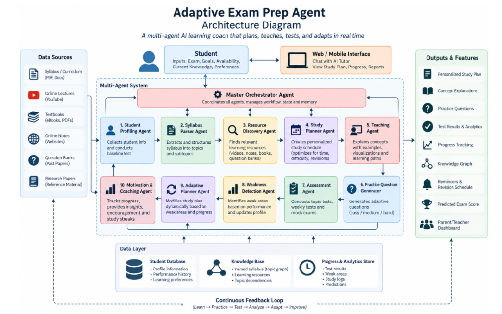

# Adaptive AI Exam Prep Agent

An intelligent, **10-agent multi-agent AI exam preparation platform** that acts as a personalized tutor, study planner, assessor, and coach. Built with a robust **FastAPI backend** (powered by LangGraph and LangChain) and a dynamic **React + Vite frontend**.

This system adapts dynamically to a student's performance, available study time, and specific exam syllabus to optimize learning outcomes through a **continuous feedback loop**: *Learn → Practice → Test → Analyze → Adapt → Improve*.

---

## 🏛️ Architecture Overview



The platform is designed around a **10-agent multi-agent system** coordinated by a **Master Orchestrator Agent**. Every agent is a specialized node in the LangGraph state graph responsible for a distinct aspect of the personalized learning pipeline.

### Master Orchestrator Agent
> **Coordinates all agents, manages workflow, state, and memory.**

The orchestrator ([`orchestrator.py`](file:///backend/app/agents/orchestrator.py)) serves as the central router in the LangGraph state machine. It receives task requests, inspects state, and conditionally delegates to the appropriate specialist agent node, handling the shared `AgentState` and ensuring seamless cross-agent communication.

### The 10 Specialist Agents (100% Implemented)

| # | Agent | File | LangGraph Node | Status | Description |
|---|-------|------|:---:|:---:|-------------|
| — | **Master Orchestrator** | [`orchestrator.py`](file:///backend/app/agents/orchestrator.py) | ✅ | ✅ Full | State router & workflow director managing agent transitions |
| 1 | **Student Profiling Agent** | [`profile_analyzer.py`](file:///backend/app/agents/profile_analyzer.py) | ✅ | ✅ Full | Analyzes student background, learning preferences, exam timelines, and baseline strengths/weaknesses |
| 2 | **Syllabus Parser Agent** | [`syllabus_manager.py`](file:///backend/app/agents/syllabus_manager.py) | ✅ | ✅ Full | Extracts and structures PDF syllabi into subjects and topics with PyMuPDF and LLM hierarchical parsing |
| 3 | **Resource Discovery Agent** | [`resource_discovery.py`](file:///backend/app/agents/resource_discovery.py) | ✅ | ✅ Full | Discovers curated learning resources (YouTube videos, textbooks, articles, notes, question banks) per topic |
| 4 | **Study Planner Agent** | [`study_planner.py`](file:///backend/app/agents/study_planner.py) | ✅ | ✅ Full | Generates structured study plans, daily schedules, milestone targets, and spaced revision intervals |
| 5 | **Teaching Agent** | [`content_tutor.py`](file:///backend/app/agents/content_tutor.py) | ✅ | ✅ Full | Interactive Socratic tutor providing concept explanations, real-world analogies, code/math snippets, and chat |
| 6 | **Practice Question Generator** | [`question_generator.py`](file:///backend/app/agents/question_generator.py) | ✅ | ✅ Full | Generates calibrated MCQs (easy, medium, hard) with detailed explanations and difficulty balancing |
| 7 | **Assessment Agent** | [`assessment_agent.py`](file:///backend/app/agents/assessment_agent.py) | ✅ | ✅ Full | Deep quiz analysis, diagnostic scoring, misconception detection, and actionable recommendations |
| 8 | **Weakness Detection Agent** | [`weakness_detector.py`](file:///backend/app/agents/weakness_detector.py) | ✅ | ✅ Full | Identifies micro-weaknesses, cognitive blockers, error patterns, and calculates urgency ratings |
| 9 | **Adaptive Planner Agent** | [`adaptive_planner.py`](file:///backend/app/agents/adaptive_planner.py) | ✅ | ✅ Full | Dynamically recalculates study schedules, inserts remedial sessions, and rebalances topic priorities |
| 10 | **Motivation & Coaching Agent** | [`coaching_advisor.py`](file:///backend/app/agents/coaching_advisor.py) | ✅ | ✅ Full | Delivers motivational coaching, burnout prevention alerts, daily study habits, and streak encouragement |

---

## 🔄 Continuous Feedback Loop

```
  ┌─────────┐       ┌──────────┐       ┌─────────┐
  │  LEARN  │ ───►  │ PRACTICE │ ───►  │  TEST   │
  └─────────┘       └──────────┘       └─────────┘
       ▲                                    │
       │                                    ▼
  ┌─────────┐       ┌──────────┐       ┌─────────┐
  │ IMPROVE │ ◄───  │  ADAPT   │ ◄───  │ ANALYZE │
  └─────────┘       └──────────┘       └─────────┘
```

1. **Learn**: Study sessions guided by the **Teaching Agent** and **Resource Discovery Agent**.
2. **Practice**: Knowledge reinforcement using the **Practice Question Generator**.
3. **Test**: Timed quizzes and topic assessments analyzed by the **Assessment Agent**.
4. **Analyze**: Mastery tracking and cognitive diagnosis by the **Weakness Detection Agent**.
5. **Adapt**: Dynamic schedule rebalancing via the **Adaptive Planner Agent**.
6. **Improve**: Continuous mastery updates feed back into personalized study plans and coaching.

---

## 📊 Features & Architecture Mapping

### Data Sources
| Data Source | Status | Implementation |
|-------------|:---:|----------------|
| **Syllabus / Curriculum** (PDF, Docs) | ✅ | PyMuPDF text extraction + LLM structured hierarchy generation |
| **Online Lectures** (YouTube) | ✅ | Resource Discovery Agent curates targeted video lecture recommendations |
| **Textbooks & Reference Material** | ✅ | Resource Discovery Agent identifies core textbook chapters & readings |
| **Online Notes & Articles** | ✅ | Resource Discovery Agent discovers authoritative web guides and documentation |
| **Question Banks & Past Papers** | ✅ | Practice Question Generator + Resource Discovery Agent for past paper banks |

### Outputs & User Features
| Feature | Status | Description |
|---------|:---:|-------------|
| **Personalized Study Plan** | ✅ | Week-by-week timeline optimized for exam dates, daily hours, and topic difficulty |
| **Concept Explanations** | ✅ | Markdown-rendered AI tutoring with follow-up questioning and analogies |
| **Practice Questions** | ✅ | Multi-tiered difficulty MCQs with instant feedback and answer explanations |
| **Test Results & Analytics** | ✅ | Comprehensive quiz scoring, accuracy trends, and subject-level performance |
| **Progress Tracking** | ✅ | Spaced repetition mastery scores (0–100%), streaks, and study logs |
| **Knowledge Graph** | ✅ | Interactive canvas dependency graph with subject clusters and mastery colors |
| **Reminders & Revision Schedule** | ✅ | Spaced repetition intervals calculated dynamically and prioritized in daily queues |
| **Predicted Exam Score** | ✅ | Multi-factor prediction engine factoring mastery, accuracy, coverage, and consistency |
| **Parent / Teacher Dashboard** | ✅ | Dedicated portal with student overview, readiness letter grades, and syllabus audits |

### Data Layer
| Store | Implementation | Contents |
|-------|---------------|----------|
| **Student Database** | `user.py`, `student.py` | Account credentials, exam profiles, target dates, study hours, streak history |
| **Knowledge Base** | `syllabus.py` | Parsed syllabi, subjects, topics, prerequisites (`TopicDependency`), resources (`LearningResource`) |
| **Progress & Analytics Store** | `analytics.py`, `assessment.py` | Test results, question logs, topic mastery metrics, coaching history |

---

## 🏗️ Project Structure

```
Adaptive-Exam-Prep-Agent/
├── backend/                             # Python / FastAPI backend
│   ├── app/
│   │   ├── agents/                      # 🤖 LangGraph Multi-Agent System (10 Agents)
│   │   │   ├── orchestrator.py          # Master Orchestrator — LangGraph StateGraph router
│   │   │   ├── profile_analyzer.py      # Agent #1 — Student Profiling Agent
│   │   │   ├── syllabus_manager.py      # Agent #2 — Syllabus Parser Agent
│   │   │   ├── resource_discovery.py    # Agent #3 — Resource Discovery Agent
│   │   │   ├── study_planner.py         # Agent #4 — Study Planner Agent
│   │   │   ├── content_tutor.py         # Agent #5 — Teaching Agent
│   │   │   ├── question_generator.py    # Agent #6 — Practice Question Generator
│   │   │   ├── assessment_agent.py      # Agent #7 — Assessment Agent
│   │   │   ├── weakness_detector.py     # Agent #8 — Weakness Detection Agent
│   │   │   ├── adaptive_planner.py      # Agent #9 — Adaptive Planner Agent
│   │   │   ├── coaching_advisor.py      # Agent #10 — Motivation & Coaching Agent
│   │   │   ├── state.py                 # Shared AgentState schema & factory
│   │   │   └── __init__.py              # Agent invocation wrapper
│   │   ├── api/                         # RESTful API Endpoints
│   │   │   ├── auth.py                  # Authentication (Register, Login, Me)
│   │   │   ├── profiles.py              # Student profiles & onboarding
│   │   │   ├── syllabus.py              # Syllabus upload, topics, resources CRUD
│   │   │   ├── study_plans.py           # Study plans, sessions, dashboard
│   │   │   ├── assessments.py           # Quizzes, questions, submission & grading
│   │   │   ├── tutor.py                 # AI tutor conversations & explanations
│   │   │   └── analytics.py             # Performance, predicted scores, graph, deep agent endpoints
│   │   ├── models/                      # SQLAlchemy Database Models (16 tables)
│   │   │   ├── user.py                  # User accounts
│   │   │   ├── student.py               # Student profiles
│   │   │   ├── syllabus.py              # Subjects, Topics, Dependencies, Resources
│   │   │   ├── study.py                 # Study plans, sessions, study logs
│   │   │   ├── assessment.py            # Questions, Assessments, Responses
│   │   │   └── analytics.py             # Topic mastery, Coaching insights, Conversations
│   │   ├── schemas/                     # Pydantic validation schemas
│   │   ├── services/                    # Business logic & LLM services
│   │   │   ├── llm_service.py           # Groq API / LLM abstraction
│   │   │   └── mastery_calculator.py    # Spaced repetition & mastery algorithm
│   │   ├── core/                        # Configuration & security
│   │   │   ├── config.py                # Environment settings
│   │   │   └── security.py              # JWT token management & hashing
│   │   ├── database/                    # Database connection & session setup
│   │   └── main.py                      # FastAPI application entry point
│   └── requirements.txt
│
├── frontend/                            # React 19 + Vite Frontend
│   └── src/
│       ├── pages/                       # 📄 Application Pages (16 total)
│       │   ├── LandingPage.jsx          # Public landing & feature showcase
│       │   ├── LoginPage.jsx            # Student authentication
│       │   ├── RegisterPage.jsx         # New student onboarding registration
│       │   ├── OnboardingPage.jsx       # Target exam, study pace & preferences
│       │   ├── DashboardPage.jsx        # Learning hub & daily session queue
│       │   ├── SyllabusPage.jsx         # PDF upload & topic management
│       │   ├── StudyPlanPage.jsx        # Calendar & day-by-day study schedule
│       │   ├── ResourcesPage.jsx        # 📚 AI Resource Discovery & saved materials
│       │   ├── KnowledgeGraphPage.jsx   # 🕸️ Interactive topic prerequisite graph
│       │   ├── TutorPage.jsx            # 🤖 AI conversational tutor with Markdown
│       │   ├── PracticePage.jsx         # ✏️ Adaptive MCQ practice quizzes
│       │   ├── AnalyticsPage.jsx        # 📈 Mastery trends, radar & accuracy charts
│       │   ├── PredictedScorePage.jsx   # 🎯 Exam score prediction engine
│       │   ├── CoachingPage.jsx         # 🏆 AI coaching advice & daily strategies
│       │   ├── ParentDashboardPage.jsx  # 👨‍👩‍👦 Parent / Teacher oversight portal
│       │   └── SettingsPage.jsx         # ⚙️ Student account & exam date settings
│       ├── components/                  # Common UI components (Navbar, ProtectedRoute)
│       ├── context/                     # Global AuthContext & state
│       ├── layouts/                     # DashboardLayout with collapsible sidebar
│       └── services/                    # Axios API client with auth interceptors
│
├── .env.example                         # Environment variable template
└── README.md
```

---

## 🛠️ Tech Stack

### Backend
| Technology | Purpose |
|------------|---------|
| **Python 3.10+** | Core programming language |
| **FastAPI** | Async REST API framework with automatic OpenAPI docs |
| **LangGraph & LangChain** | Multi-agent coordination with state graph and conditional routing |
| **Groq API** | High-speed LLM inference (Llama-3.3-70b-versatile, OpenAI-compatible) |
| **SQLAlchemy 2.0 (Async)** | Async ORM with SQLite (default) and PostgreSQL support |
| **PyMuPDF (fitz)** | Fast PDF syllabus extraction |
| **Pydantic v2** | Data validation and schema enforcement |
| **httpx** | Async HTTP client for external integrations |

### Frontend
| Technology | Purpose |
|------------|---------|
| **React 19 + Vite** | Modern reactive UI framework with fast HMR |
| **React Router DOM v7** | Client-side routing with protected layouts |
| **HTML5 Canvas / SVG** | Interactive Knowledge Graph visualizer |
| **Recharts** | Interactive charts for mastery, performance, and predictions |
| **React-Markdown** | Rich markdown rendering with code highlighting in AI tutor |
| **Custom Modern CSS** | Dark-mode glassmorphic design system |

---

## 💻 Getting Started

### Prerequisites
- **Node.js** (v18+ recommended)
- **Python** (v3.10+ recommended)
- **Groq API Key** (optional — the platform includes built-in fallback/demo modes for all agents if no key is supplied)

### 1. Clone the Repository
```bash
git clone https://github.com/sudarshan026/Adaptive-Exam-Prep-Agent.git
cd Adaptive-Exam-Prep-Agent
```

### 2. Backend Setup
```bash
cd backend
python -m venv venv

# Activate virtual environment
# Windows (PowerShell):
venv\Scripts\Activate.ps1
# Mac / Linux:
source venv/bin/activate

# Install dependencies
pip install -r requirements.txt

# Configure environment variables
cp .env.example .env
# Open .env and add your GROQ_API_KEY (optional, enables real-time LLM inference)

# Launch backend server
uvicorn app.main:app --reload --port 8000
```
Backend will be live at `http://localhost:8000`. Interactive Swagger API Docs available at `http://localhost:8000/docs`.

### 3. Frontend Setup
In a new terminal window:
```bash
cd frontend
npm install

# Start development server
npm run dev
```
Frontend will be live at `http://localhost:5173`.

---

## 🔑 Environment Variables

| Variable | Required | Default | Description |
|----------|:--------:|:-------:|-------------|
| `DATABASE_URL` | No | `sqlite+aiosqlite:///./exam_prep.db` | Database connection string |
| `JWT_SECRET_KEY` | Yes (in prod) | `dev-secret-key...` | Secret key for JWT signing |
| `GROQ_API_KEY` | No | `""` | Groq API key for LLM agents (demo mode if blank) |
| `YOUTUBE_API_KEY` | No | `""` | YouTube Data API key for resource discovery |
| `CORS_ORIGINS` | No | `http://localhost:5173,...` | Allowed CORS origins list |

---

## 📄 License
This project is open-source under the [MIT License](LICENSE).
